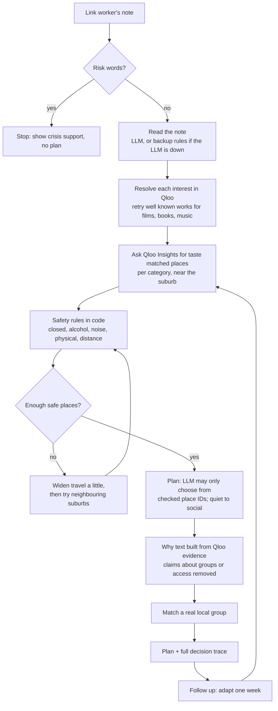

# Kindred

**An agent that helps social prescribing link workers turn a lonely person's tastes into a gentle, safe, three week plan of real places nearby, using Qloo's taste intelligence.**

**Live demo:** https://kindred-9rzv.onrender.com
(free hosting: if the page takes 30 seconds to wake up, that's the server starting, not an error)

---

## Try it in 30 seconds

1. Open the live demo.
2. Click a sample note (for example the widowed gardener in Marrickville who loves Fleetwood Mac).
3. Press **Make a plan**. In a few seconds you get three weeks, quietest first, each with a real place, why it fits her tastes, and how far it is.
4. Open **How Kindred decided** to see every step the agent took: what it understood, what Qloo returned, which places it hid and why.
5. Under week 1, press **Didn't happen** and pick a reason such as *too far*. Kindred replaces that week with something closer and tells you what changed.

Or write your own note. Kindred works for 48 suburbs across Sydney's Inner West, inner city, eastern suburbs and Mascot.

## The problem

One in three Australians feels lonely, and loneliness carries health risks comparable to smoking. GPs can now refer lonely patients to a **social prescribing link worker**, who helps them reconnect with their community.

The hard part is the first step. A generic suggestion like "join a club" rarely works for someone who hasn't left the house in months. What works is something that feels like *them*: a place where people who share their tastes already go, close enough to reach, calm enough to walk into alone. Finding that for every patient, by hand, takes a link worker hours.

## What Kindred does

A link worker pastes a short note, written the way they'd normally write it:

> *81, lives alone in Leichhardt since her husband died, loved ballroom dancing and André Rieu, uses a walking stick, takes the bus.*

Kindred returns:

* **A three week plan.** Week 1 is the quietest place (a park or library), week 3 the most social (a café or community centre). Each step names a real place, its distance, and *why* it fits, using Qloo's evidence: "popular with people who enjoy ballroom dancing and André Rieu".
* **A real local group** to join when they're ready, from a hand checked list with source links (for example the Haberfield Men's Shed for a retired carpenter).
* **Safety by default.** No pubs, bars or alcohol focused places. No closed, loud, tourist crowded, or physically demanding venues for frail people. Nothing beyond how far they can travel.
* **Follow up.** Each week can be marked *It went well* or *Didn't happen*, with a reason (too far, too busy, not ready, not their thing). Kindred adapts that week.

## How Qloo is used

Qloo is the heart of Kindred. The LLM never chooses a place on its own.

| Step | Qloo endpoint | What it's for |
|---|---|---|
| Understand interests | `/search`, `/v2/tags` | "André Rieu" becomes a Qloo artist entity; "gardening" becomes a Qloo keyword tag. Strict name matching stops "Studio Ghibli" turning into a yoga studio. |
| Find taste matched places | `/v2/insights` with `filter.type=urn:entity:place` | One call per place category (park, library, museum, café, community centre and more), filtered by `filter.location.query` and signalled by the person's interests and `signal.demographics.age`. |
| Explain the match | Insights tags and popularity | The "why" for each place is built in code from Qloo's own evidence, so it can't be invented. |
| Check safety | Place tags and properties | Category tags, `is_closed`, and descriptive tags (alcohol, noise, crowds, accessibility) feed plain code safety rules. |

Things we learned about the API and handled in code: search is worldwide, so distance from the suburb is computed for every place; the radius filter isn't reliable, so distance limits are enforced locally; and category filters are loose, so every place's own category tags are checked.

### One request, start to finish (redacted)

Note: *"74, widowed last year, loved gardening and Fleetwood Mac, can't drive, lives in Marrickville."*

1. **Read:** age band `55_and_older`, suburb `marrickville`, travel `bus` (5 km), interests *gardening* (hobby) and *Fleetwood Mac* (artist). No name or contact details are kept or sent.
2. **Resolve:** `/v2/tags` for "gardening" returns the keyword tag `urn:tag:keyword:qloo:gardening`. `/search` for "Fleetwood Mac" with `types=urn:entity:artist` returns the band's entity; the exact name match is kept, near misses are rejected.
3. **Ask for places:** one `/v2/insights` call per interest and place category, for example:

   ```
   filter.type=urn:entity:place
   filter.tags=urn:tag:category:place:park
   filter.location.query=marrickville, Sydney
   signal.interests.tags=urn:tag:keyword:qloo:gardening
   signal.demographics.age=55_and_older
   take=15
   ```
4. **Check:** each returned place gets a distance from Marrickville and passes through the safety rules. In this example 16 alcohol focused, 12 loud, 1 not visitable and 1 too physical place were hidden.
5. **Result:** Marrickville Park (1 km), *"popular with people who enjoy gardening and Fleetwood Mac; tagged Community gardening, which fits gardening"*, then Gough Whitlam Park, then Bourke Street Bakery, then the Addison Road Community Garden working bee.

### What a Qloo result does and doesn't mean

Qloo results describe **aggregate** taste affinities: "people who enjoy gardening and Fleetwood Mac also tend to enjoy this park". Kindred presents them that way and never as a prediction about the individual. Kindred never sends Qloo a name, contact details, health information or a location history; only interests, a suburb name and an age band. The person's needs (walking aids, not drinking) are handled by Kindred's own rules, not inferred from Qloo.

### Qloo access

Kindred calls the event's Qloo API (`hackathon.api.qloo.com`) directly from the server, using the same endpoints as the kit's `qloo api` route. The key lives only in a server environment variable, never in the repo or the browser. Every response is cached on the server to stay well inside the event quota, and retries are bounded.

## How the agent works



Every step is recorded in a trace that the link worker can open, so nothing is a black box.

**Design rules that make it trustworthy**

* The LLM is only used to *read* the note and to *order* places that code has already checked. It can only return IDs from the checked list; anything else is rejected.
* If the LLM fails or is rate limited, Kindred still works: a rules based reader understands the note and a rules based planner orders the places.
* If there aren't enough safe places in reach, Kindred gives a shorter plan rather than inventing one.

## Results

We compared Kindred with a plain LLM on 20 realistic notes. Both used the same model, the same note, and the same instructions (calm places, no alcohol venues, within reach, real places only). The only difference: Kindred grounds every place in Qloo and checks it in code. Every suggested place was then looked up by name in Qloo, the same way for both systems.

| Check | Kindred | Plain LLM |
|---|---|---|
| Confirmed as a real place within 15 km | **72%** | 13% |
| Within reach for how the person travels | **98%** | 75% |
| Alcohol focused or closed venues | **0** | 0 |
| Plans with all three weeks | 18 of 20 | 20 of 20 |

The plain LLM writes smoother, more specific sounding plans ("Glebe Community Choir", "Kingsford Chess Club"), but 87% of its places could not be confirmed as real places nearby. Every Kindred place is a real Qloo place with coordinates; the name lookup misses some of them, so Kindred's true figure is higher than 72%. The two shorter Kindred plans were for people who can only walk a few hundred metres, where only two safe places were in reach.

Full method and numbers: [eval/RESULTS.md](eval/RESULTS.md). The evaluation is reproducible with `python -m eval.run_eval`.

## Privacy and safety

* **Notes are never stored.** Emails and phone numbers are removed before anything is sent to a model.
* **Risk check first.** Notes that mention self harm or suicide stop immediately: no plan is made, and the link worker is told to follow their service's escalation process. This runs in code, before any LLM call.
* **Rate limited** to protect the free API keys.
* **Qloo data stays private.** Responses are cached on the server only, never committed to this repo.
* Kindred supports a link worker's judgement; it doesn't replace it. Every group has a source link and a "checked" date so details can be confirmed before referral.

## Run it yourself

```bash
git clone https://github.com/annarose14/kindred.git
cd kindred
python3 -m venv venv && source venv/bin/activate
pip install -r requirements.txt
cp .env.example .env        # then add your Qloo and Groq keys
uvicorn app.main:app --reload
```

Open http://127.0.0.1:8000. Run the tests with `python -m pytest` (230 tests, all offline with fake Qloo and LLM clients). Try notes from the command line with `python try_agent.py`.

**Stack:** Python, FastAPI, Qloo Insights API, Groq (gpt-oss-120b with gpt-oss-20b as a backup), plain HTML and JavaScript, hosted on Render, tests on GitHub Actions.

## Project layout

```
app/
  agent.py     the agent loop, trace and follow up adaptation
  intake.py    risk check, note reader (LLM with a rules backup)
  matcher.py   Qloo interest resolution and place matching
  safety.py    plain code safety rules
  planner.py   quiet to social plan, evidence based "why"
  groups.py    hand checked local groups with sources
  suburbs.py   pilot suburbs
  llm.py       Groq client with backup model and cache
  main.py      web API
static/        the web page
eval/          Kindred vs plain LLM evaluation
tests/         230 offline tests
```

## Limitations and next steps

* **Pilot area:** 48 Sydney suburbs. Adding a city means adding suburb coordinates and checking local groups.
* **Groups are hand checked.** Qloo knows places, not clubs, so the 14 groups come from council and library pages. A real deployment would connect to a local services directory.
* **Qloo has fewer libraries and community centres** than cafés and parks in some suburbs, so some plans lean on cafés.
* **The evaluation is small** (20 notes) and the name lookup misses some real places.
* Next: test with practising link workers, add more cities, and let the link worker edit a step before printing.

## Licence

MIT. See [LICENSE](LICENSE).

Built by Anna Rose Bijoy for the Qloo Agentic Hackathon 2026.
